# C 盘清理 · CleanC v2.5

一个真实可用的 Windows 清理、卸载与防护工具：扫描 C 盘、按规则引擎判断哪些能删，清理注册表与软件残留，按「普通 / 强力」两种方式卸载已安装软件，并提供带实时监控、篡改拦截、危害文件处置的主动防御模块。白色 + 清爽蓝界面（可一键切换深色），单文件 exe，不需要安装运行时。

底层有两种视图：**普通模式**（四页签：清理 / 卸载 / 残留 / 防护）与 **文件模式**（SpaceSniffer 风格的文件地图，按体积铺满、四级风险配色、右键直接操作文件）。

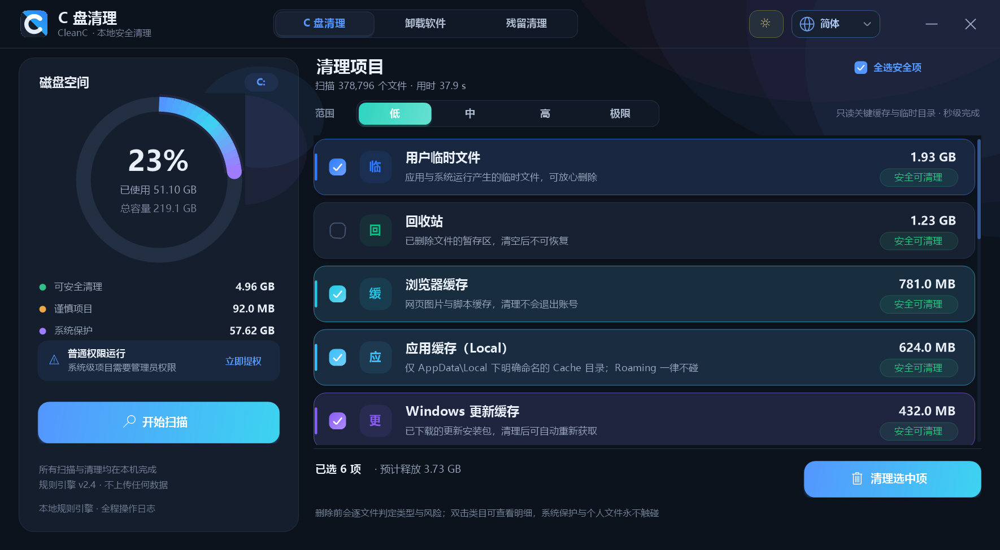

- 单文件 exe（约 485 KB），Windows 10/11 自带 .NET Framework 4.8 即可运行
- 明暗双主题：标题栏右上角一键切换，首次运行跟随系统，选择记入 `settings.ini`
- 首次运行语言跟随系统：简体中文 / 繁體中文 / English，可随时在标题栏切换
- 本地规则引擎，不上传任何文件
- System32 / WinSxS / Program Files / 用户文档一律禁止删除
- 触及注册表与命令的操作，必须先通过免责声明与管理员授权

## 下载与安装

- 直接运行仓库里的 [dist/CleanC.exe](dist/CleanC.exe)（中文名副本为 `dist/C盘清理.exe`，或下载 Releases 中的同名文件），**免安装**、不需要额外下载运行时。
- 系统要求：Windows 10 / 11（x64），.NET Framework 4.8（系统自带）。
- 未签名 exe 首次运行可能触发 SmartScreen：点「更多信息 → 仍要运行」即可；程序不会修改任何系统安全策略。
- 配置与日志都写在 `%LOCALAPPDATA%\CleanC\`，删除该目录即可完全卸载（无注册表驻留）。

## 功能

### 一、C 盘清理（四档范围）

| 档位 | 范围 | 是否需管理员 | 典型耗时 |
|---|---|---|---|
| **低** | 只读取关键可删项：用户临时文件、浏览器缓存、缩略图缓存、崩溃转储、回收站 | 否 | 毫秒级 |
| **中** | 低 + 系统临时目录、Windows 更新缓存、字体缓存、交付优化、预读取、系统日志、安装包缓存、旧系统备份 | 部分项目需要 | 秒级 |
| **高** | 全盘逐文件枚举，完整统计「安全 / 谨慎 / 系统保护 / 其他」四类 | 部分目录需要 | 十几秒 |
| **极限** | 全盘 **3 轮**扫描 + 16 步软件残留全量扫描（目录 / 任务 / 启动项 / 防火墙 / 服务 / 全量注册表 / 驱动 / 浏览器 / 日志） | **需要** | 数十秒 |

- 低 / 中只做定向目录测量，不会遍历整盘，因此可以随时点「重新扫描」秒级切换。
- 极限档的 3 轮扫描会累加统计耗时与文件数，底部显示「第 x/3 轮」，用于捕捉扫描期间新产生的临时文件。
- 切换档位后旧结果会清空，提示重新扫描，避免用低档结果做高档承诺。

### 二、卸载软件（普通 / 强力）

| 方式 | 做什么 | 不做什么 |
|---|---|---|
| **普通删除** | 删除安装目录下的全部文件与空子目录，清理开始菜单 / 桌面 / 快速启动中指向该目录的快捷方式 | 不结束进程、不调用命令、**不碰注册表** |
| **强力删除** | 普通删除的全部内容 + 结束该目录下的进程（`taskkill`）+ 必要时取得目录所有权（`takeown` / `icacls`）+ 备份并删除该软件自身的注册表项（`reg export` / `reg delete`） | 不会删除系统组件、驱动、运行库 |

- 程序列表来自注册表 `Uninstall` 项（HKLM / HKCU，含 WOW6432Node），自动过滤更新补丁、系统组件、无卸载信息的条目。
- 每个条目显示体积（优先取 `EstimatedSize`，缺失时实测目录）、发布者、版本、安装目录、作用域（所有用户 / 当前用户）。
- 受保护程序在列表中显示锁图标且不可勾选，原因会写在详情里（运行库、Microsoft 组件、显卡/驱动包、系统路径、目录层级过浅、未找到安装目录）。
- 普通删除完成后条目会保留并标记「文件已删除」，此时切到强力删除即可对这种「只剩注册表」的软件继续清理；也可以一开始就手动切到强力删除。
- 强力删除不会调用软件自带卸载程序，因此 MSI 安装的软件仍需自行用官方卸载器处理更深的 COM / 服务注册。

### 三、残留清理（16 步全量扫描）

顶层第三个页签「残留清理」，进入即自动扫描。扫描不再只查注册表的几个固定位置，而是按你指定的 **16 步流程**完整走一遍，能对上的残留都会列出来：

| 步骤 | 检查内容 | 判定依据 | 默认勾选 |
|---|---|---|---|
| 1 | `Program Files` / `Program Files (x86)` 安装目录 | 能和失效卸载项对上；或目录里已无 exe / dll 且没有任何安装记录 | 否（改名观察） |
| 2 | `%ProgramData%` 公共配置 / 缓存 / 更新包 | 目录名能和失效卸载项对上 | 否 |
| 3 | `%LocalAppData%` / `%AppData%` / `%LocalLow%` | 同上（含厂商\产品二级目录） | 否 |
| 4 | 计划任务（`System32\Tasks` XML） | `<Command>` 指向的 exe 已不存在，且不是系统自带任务 | 否 |
| 5 | 启动项 | `Run` / `RunOnce`（HKLM / HKCU / WOW6432Node）指向的 exe 不存在；`StartupApproved` 里对应启动项已删除 | 是 |
| 6 | 防火墙规则（`HNetCfg.FwPolicy2` COM） | 规则的 `ApplicationName` 指向的文件不存在；系统路径与 `System` 占位不碰 | 否 |
| 7 | 残留服务 / 驱动 | `Services\*` 的 `ImagePath` 文件不存在；执行时先 `sc stop` 再 `sc delete` | 否（需重启） |
| 8 | 注册表 Uninstall | `Uninstall`（HKLM / HKCU / WOW6432Node）指向的程序与目录都不存在；同名软件仍安装则视为重装旧键跳过 | 是 |
| 9 | `HKCU\Software`、`HKLM\SOFTWARE`、`WOW6432Node` | 全量递归扫描：卸载项失效后仍残留的产品主键；深层键里 `InstallPath / InstallLocation / ExePath / LocalPackage` 等值指向不存在的路径 | 主键勾选，深层值不勾 |
| 10 | `Classes` | 全量递归扫描：CLSID 的 `InprocServer32 / LocalServer32` 文件缺失；右键菜单处理程序指向失效 CLSID；`shell\<动词>\command` 与 `Applications\<exe>` 指向失效程序；`OpenWithProgids` 里不存在的 ProgID；`OpenWithList` 里与失效卸载项同名、且程序已不存在的条目 | CLSID / 菜单 / 关联不勾，失效 ProgID 勾选 |
| 11 | `Installer` 安装缓存 | `Installer\UserData\<SID>\Products\<GUID>\InstallProperties` 的 `InstallLocation` 或 `LocalPackage` 指向不存在的路径；先 `.reg` 备份再删除 | 否 |
| 12 | 驱动与设备类 GUID | `Class\{GUID}` 的 `UpperFilters / LowerFilters` 指向失效筛选器；未被任何设备或服务引用的 `oem*.inf`（**管理员 cmd 强制删除**：`pnputil /force` + `takeown/icacls/del/rd` 回退）；`Enum` 里 Service 已不存在的隐藏设备 | 否（需重启） |
| 13 | 浏览器扩展 | Chrome / Edge / Brave / Chromium / Vivaldi 各配置目录中，扩展本体已不存在但 `Local Extension Settings / Sync Extension Settings / Extension State / Storage\ext / IndexedDB` 数据仍在；仍在 `Preferences / Secure Preferences` 注册的扩展（含 Edge 内置组件扩展）不列为残留 | 否（需先关闭浏览器） |
| 14 | 快捷方式与应用列表 | 开始菜单 / 桌面 / 启动目录 / 快速启动 / 任务栏固定项中指向已删文件的 `.lnk`；`RegisteredApplications` 指向不存在的能力键 | 否 |
| 15 | 事件日志源、临时文件、更新缓存 | `EventLog\Application|System\<来源>` 的消息文件缺失；7 天以上未修改的临时文件；`SoftwareDistribution\Download` 与交付优化缓存（改名观察） | 临时文件勾选，其余不勾 |
| 16 | 清理后验证 | 重新复查任务 / 防火墙 / 服务 / 事件日志 / 隐藏设备，并提供 `sfc /scannow`、`DISM /CheckHealth`、事件查看器、系统还原入口 | — |

**清理与回退方式：**

| 类型 | 执行方式 |
|---|---|
| 注册表键 / 值 | 先 `reg export` 备份到 `%LOCALAPPDATA%\CleanC\regbackup\<时间戳>\`，再 `reg delete` |
| 服务 / 驱动服务 | `sc stop` → `sc delete` → 回查 `Services\<名字>` 是否消失 |
| 计划任务 | `schtasks /Delete /TN` |
| 防火墙规则 | 通过 COM 精确匹配「规则名 + 程序路径 + 方向」后 `Rules.Remove` |
| 驱动包 | 打开**管理员模式的 cmd**（`runas`），执行 `pnputil /delete-driver <oem*.inf> /uninstall /force`；失败时回退 `takeown` + `icacls` + `del` 发布 INF，并删除 DriverDatabase 映射到的 `DriverStore\FileRepository` 目录 |
| 筛选器 | 读取 `UpperFilters / LowerFilters` 的 `REG_MULTI_SZ`，移除失效项后写回（先导出 `.reg`） |
| 目录 / 浏览器扩展数据 | 只改名 `xxx.CleanC_bak`，随时可改回 |
| 临时文件 / 快捷方式 | 直接删除（`.lnk` 与 7 天以上临时文件） |

删除过程**会真的弹出命令提示符窗口**：程序把每个注册表键写成 `reg export` + `reg delete`，服务写成 `sc` 命令，任务写成 `schtasks`，驱动写成 `pnputil`，`cmd /c` 逐条执行，窗口里能看到每一条。跑完后程序不信批处理的返回值，而是**逐个回查真实状态**（注册表键、任务文件、防火墙规则、服务键、目录 / 文件是否存在）确认后，再告诉你成功几项、失败几项。

安全约束（`RegGuard`）：

- 允许：Uninstall、App Paths、`Run` / `RunOnce` 的值、`StartupApproved` 的值、`SOFTWARE\<产品>`（一层）、`SOFTWARE` 深层里**可验证的失效路径值**、`Services\<名字>`、`Classes\CLSID\<GUID>` / `ContextMenuHandlers` / `shell\<动词>` / `Applications\<exe>`、`Installer\UserData\...\InstallProperties`、`EventLog\<日志>\<来源>`、`Class\{GUID}` 的过滤值、`Enum\<总线>\<设备>\<实例>`
- 拒绝：`SOFTWARE\Microsoft`、`Windows`、`Policies`、`Clients`、`RegisteredApplications`、`WOW6432Node` 等厂商/系统键；`Tcpip`、`Disk`、`Ntfs`、`Win*`、`Ms*` 等关键服务；`Security` 事件日志；`ROOT` / `HTREE` 设备；`Program Files\Common Files`、`Microsoft` 等厂商共享目录里的 COM/关联目标
- 每条注册表删除都先 `reg export` 到备份目录，命令与批处理文件留在 `%LOCALAPPDATA%\CleanC\regcmd\`

### 四、主动防御（防护设置页）

第四个页签「防护设置」提供一个可开关的主动防御模块。首次开启时对系统做一次完整性快照（基线），之后按档位周期复查。所有检查都在本地完成，不联网、不上传。

| 档位 | 频率 | 检查内容 |
|---|---|---|
| **低** | 每 60 秒 | 12 个 System32 关键文件指纹 + 10 个关键注册表值 + IFEO 调试器劫持 |
| **高** | 每 15 秒 | 低档全部内容 + 启动项 / 启动目录 / Temp / Downloads 的危害文件清扫（危害文件扫描最快每 60 秒一轮） |

**系统完整性**

- 对 `kernel32 / ntdll / user32 / advapi32 / gdi32 / shell32 / winlogon / services / lsass / svchost / cmd / taskmgr` 记录 SHA-256 与修改时间；文件未被改动时只比较大小与时间戳，几乎不耗 CPU。
- 大小 / 时间变化时才重新哈希。若新文件的版本信息仍由 Microsoft 签发，视为 Windows 更新并静默刷新基线，避免把每月补丁误报为篡改；否则列为「系统文件被篡改」。
- 注册表基线覆盖 Winlogon `Shell / Userinit`、`AppInit_DLLs / LoadAppInit_DLLs`（含 WOW6432Node）、SafeBoot `AlternateShell`、Windows Defender 的 `DisableAntiSpyware / DisableRealtimeMonitoring`；值一旦偏离基线就报告，并支持一键恢复基线值（无管理员权限时会提示需要提权）。
- 枚举 `Image File Execution Options` 下所有 `Debugger`：新增或指向临时目录 / 用户目录的项按「镜像劫持」高风险报告。

**发现篡改之后**

1. 立即扫描当前进程，只针对从 `Temp / Downloads / Public / ProgramData` 等可疑位置启动、且未签名或最近启动、或伪装系统进程名的进程执行终止；Windows 目录与 `Program Files` 下的进程永不触碰。高档门槛更低（命中一个附加特征即终止），低档需要同时命中更多可疑特征。
2. 右下角弹出置顶提示（带红色警示条与「查看方案」按钮），提示会写明发现的风险数量与已终止的进程数；主窗口最小化时也会弹出。
3. 点击「查看方案」进入风险详情：说明、目标路径、处置建议与可执行按钮（隔离文件 / 禁用启动项 / 立即修复注册表 / 忽略）。

**危害文件检查**

- 启动项（HKLM / HKCU / WOW6432Node 的 `Run / RunOnce`）与启动目录：指向临时目录、双扩展名伪装（如 `invoice.pdf.exe`）、隐藏文件、伪装系统进程名（如 `Temp\svchost.exe`）的项会列出。
- `%TEMP%`、`Windows\Temp`、`Downloads` 顶层可执行文件：隐藏属性、双扩展名、伪装系统名、`.scr` 格式会被标记为高危。
- 处置方式：文件移入 `%LOCALAPPDATA%\CleanC\quarantine\`（保留原文件名与时间戳，不会直接删除）；启动项先写日志再删除对应值；高风险文件若正在运行，会先终止进程。

防护开关、档位写入 `settings.ini`（`defense.enabled` / `defense.level`），基线与忽略列表分别保存在 `%LOCALAPPDATA%\CleanC\defense_baseline.dat`、`defense_ignore.txt`，事件日志追加到 `%LOCALAPPDATA%\CleanC\logs\defense.log`（超过 2 MB 自动轮转）。

| 防护页（深色） | 右下角拦截提示 | 风险详情与解决方案 |
|---|---|---|
| 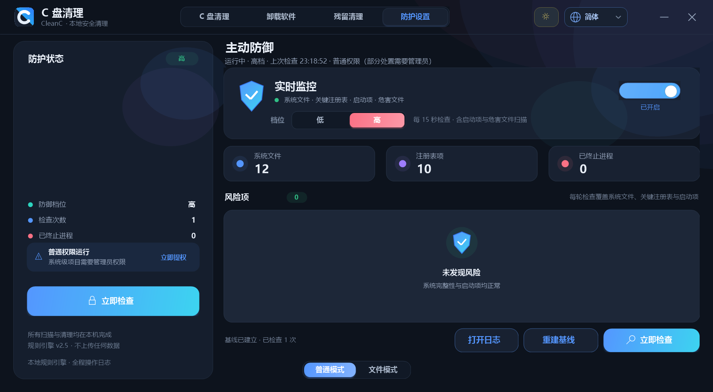 |  | 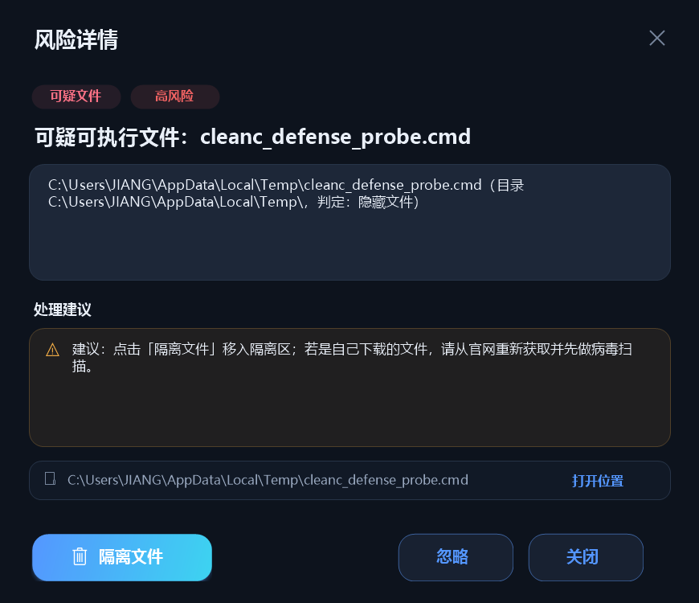 |

### 五、极限档的清理顺序（AppData 原则）

极限档不是「一股脑全删」，而是按固定顺序推进，越靠后越谨慎：

| 顺序 | 阶段 | 内容 |
|---|---|---|
| ① | 系统与临时缓存 | 用户临时文件、系统临时、Windows 更新缓存、交付优化、字体缓存、预读取、系统日志、缩略图、崩溃转储 |
| ② | 软件自带缓存 | 浏览器缓存（等同于在各软件里点「清除缓存」） |
| ③ | 卸载残留与旧系统 | 安装包缓存、`Windows.old` |
| ④ | Local 手动缓存 | **只限** `AppData\Local` 下明确命名为 `Cache / Code Cache / GPUCache / ShaderCache / CacheStorage` 的目录 |
| ⑤ | 回收站 | 清空回收站 |
| ⑥ | 注册表垃圾 | 最后处理，单独授权 + 逐项 `.reg` 备份 |

顺序会在列表上用 ①…⑥ 的编号徽标标出来，清理时也严格按该顺序执行（`sel.Sort(Stage)`）。

**极限档的这一行永远显示**：即使扫到 0 项，也显示「已检查 / 0 项 / 未发现注册表垃圾」，并在顶部汇总里追加「· 注册表垃圾 N 项」，不用滚动就知道检查过、结果如何。非管理员点极限扫描时若拒绝提权，仍会继续只读扫描（只在真正删除时才再次要求管理员权限）。

**红线（代码级硬拦截，不依赖界面勾选）：**

- `AppData\Roaming`、`AppData\LocalLow` 下的**任何内容**都不可删除 —— 写入前缀黑名单，`IsForbidden()` 直接拒绝。
- `AppData`、`AppData\Local` 这两个**根目录本身**不可删除 —— 写入精确匹配黑名单。
- 名称里带 `Data / Database / Profile / Settings / User Data / Session / Login` 的目录一律不算缓存，只匹配白名单名字。
- 正在运行的程序，其缓存整个跳过（进程名与路径段匹配），列表里会显示「N 个缓存正被程序占用，已跳过」。
- 不进入缓存目录内部继续下钻，避免把缓存旁边的数据目录一起带走。

### 六、启动动画

一段有情节的开场（约 3.1 秒，可点击跳过）：

1. 一个蓝色 **C** 从左侧蹦蹦跳跳跳进场，落地时有挤压形变与地面阴影
2. C 在中间站定，影子收拢
3. 一个纸箱从上方砸下来，**盖住 C**，落点有压扁回弹、冲击波与尘土
4. 白光一闪，纸箱「变成」Logo
5. Logo 放大展示（1.0 → 1.32 倍），轨道环与两颗卫星点绕行
6. 标题逐字上浮、副标题与进度条淡入
7. 三行状态文案打勾，进度条流光扫过
8. 整体轻微放大并淡出到主界面

**帧率与卡顿排查**

软件没有写死 30 帧；动画定时器请求 15ms（约 60 帧）。但实测启动动画曾只有 **5–9 帧**（每帧绘制 100–170ms），主界面持续重绘约 **36–40 帧**，所以体感“像被锁在 30 帧”。原因与修复：

| 原因 | 修复 |
|---|---|
| 每帧 new Font（GDI+ 中文字体创建很贵） | 加字体缓存，整个进程只创建一次 |
| 启动动画逐帧 `MeasureString` 每个标题字 | 标题宽度只量一次并缓存 |
| 每帧重建 3 个 600px `PathGradientBrush` 光晕 | 背景光晕一次性烘焙成不透明位图，每帧仅 SourceCopy |
| 大范围抗锯齿椭圆反复填充 | 多层同心半透明圆近似径向渐变 |
| WinForms 定时器精度 15.6ms，16ms 会被取整到 ~31ms | `timeBeginPeriod(1)` + 15ms 动画定时器 |

修复后本机实测：**启动动画 45–56 帧**（绘制 10–13ms/帧），**主界面持续重绘 37–43 帧**（绘制 15ms/帧）。可随时复测：

```
dist\C盘清理.exe --fpsprobe --out fps.json
```

JSON 会输出主界面 `fps / paintMs / ticks` 与启动动画 `splashFps / splashPaintMs` 以及各绘制阶段耗时。

### 七、Logo

圆角方块沿对角线一分为二：**左下角白色、右上角蓝色**（蓝色一侧自带蓝→青渐变）。
C 字形在白色一半上用蓝色、在蓝色一半上用白色 —— 两半都保持对比度，拼起来是一个完整的斜切 C。
白色一半贴着一张极淡的描边，保证在白色界面上也能看到轮廓。

### 八、深色模式

标题栏语言切换左边多了一个圆形按钮：浅色时显示月亮，深色时显示太阳，点一下即时换肤，不需要重启。

| 浅色 | 深色 |
|---|---|
|  | 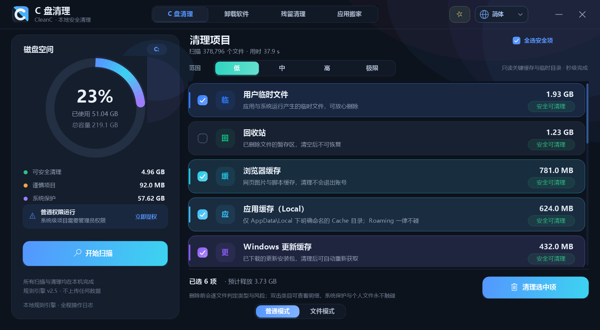 |

- **首次运行跟随系统**：读 `HKCU\...\Themes\Personalize\AppsUseLightTheme`，系统是深色就直接进深色。
- **之后记住你的选择**：点击会写入 `%LOCALAPPDATA%\CleanC\settings.ini` 的 `theme=` 键，与 `lang=` 共用一个文件、互不覆盖。
- **整屏一起换**：主窗体、各类列表、分段控件、环形图、启动动画、防护页与全部弹窗都按调色板重绘；深色下文字改用灰度抗锯齿，避免 ClearType 在暗底上出现彩边。
- **配色不是简单反相**：暗色底 `#0D131D`、卡片 `#182131`、正文 `#E9EFF8`，蓝色提亮到 `#5496FF` 保证暗底对比度；阴影改成纯黑并加重，淡色底纹（图标底色、chip）的透明度按系数提亮，否则在暗底上会消失。

### 九、文件模式（文件地图）

窗口底部中央是 `普通模式 | 文件模式` 开关，每次启动都默认进入**普通模式**。切换带滑入回弹、区块按层级错峰展开、横向扫光与左边缘青色光晕，开关胶囊同时闪白一次；普通模式保留原有四页签，文件模式占满整窗（隐藏左面板）。

文件模式用 SpaceSniffer 风格矩形树图展示 C 盘：**区块面积与该目录 / 文件的体积成正比**，一级目录套一级，越深越小；首次进入扫描全盘（本机 31 万文件，约 30–40 秒，可取消），结果缓存，点面包屑右侧「刷新」重新统计。

| 颜色 | 含义 | 判定 |
|---|---|---|
| 绿 | 可清理 | 规则引擎判为 Safe 的缓存 / 临时文件 |
| 黄 | 谨慎 | Caution：`Windows.old`、`Prefetch`、`Logs`、`Package Cache` |
| 红 | 勿动 | 个人资料、程序、未分类内容（删除前用高风险确认） |
| 黑 | 绝对禁区 | `System32`、`SysWOW64`、`WinSxS`、`Boot`、`servicing`、`Fonts`、`Windows\Installer`、`Program Files*`、`AppData\Roaming`、`AppData\LocalLow`、根目录系统文件 |

| 操作 | 行为 |
|---|---|
| 悬停 | 评价卡：名称、风险标签、完整路径、体积与占父级比例、文件数、子树四类体积、规则说明与操作提示 |
| 左键 | 打开该区块：目录用资源管理器打开，文件定位并选中；单击延迟 300 ms，以兼容双击 |
| 双击 | 钻入该目录；面包屑可返回上级或跳到任意层；「刷新」重建整张地图 |
| 右键 | 删除 / 剪切 / 粘贴 / 复制 / 属性 / 垃圾清理排查 |
| 垃圾清理排查 | 只读统计该区块可回收体积与分类，勾选分类后点「清理选中」才会永久删除；黑区与个人文档自动跳过，日志写入 `%LOCALAPPDATA%\CleanC\logs` |

安全约束：

- **删除是永久删除**（不进回收站），每次操作先弹自绘确认框；红色区块使用高风险样式与红色确认按钮。
- 黑色区块的删除 / 剪切在菜单里置灰，并在 `FileOps` 执行层再次校验 `RuleEngine.IsHardBlocked`；粘贴目标若是禁区同样拒绝写入。
- `C:\` 顶层目录（`Windows`、`Users`、`Program Files`…）在文件地图内禁止删除 / 剪切，避免整目录级误伤。
- 垃圾清理逐文件复查 `IsForbidden` 与 `FileJudge`（个人文档、正在运行程序的缓存自动跳过）。

| 文件模式（浅色） | 文件模式（深色） |
|---|---|
| 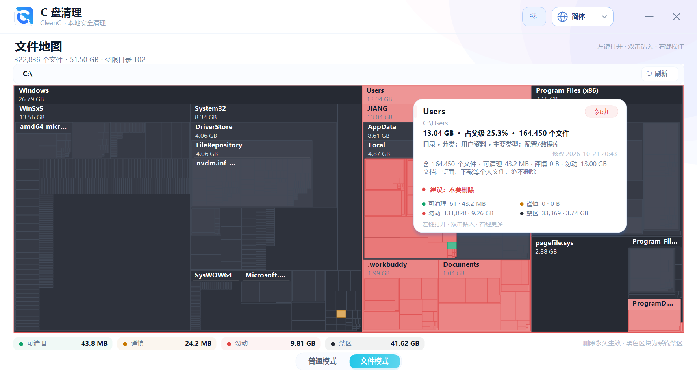 | 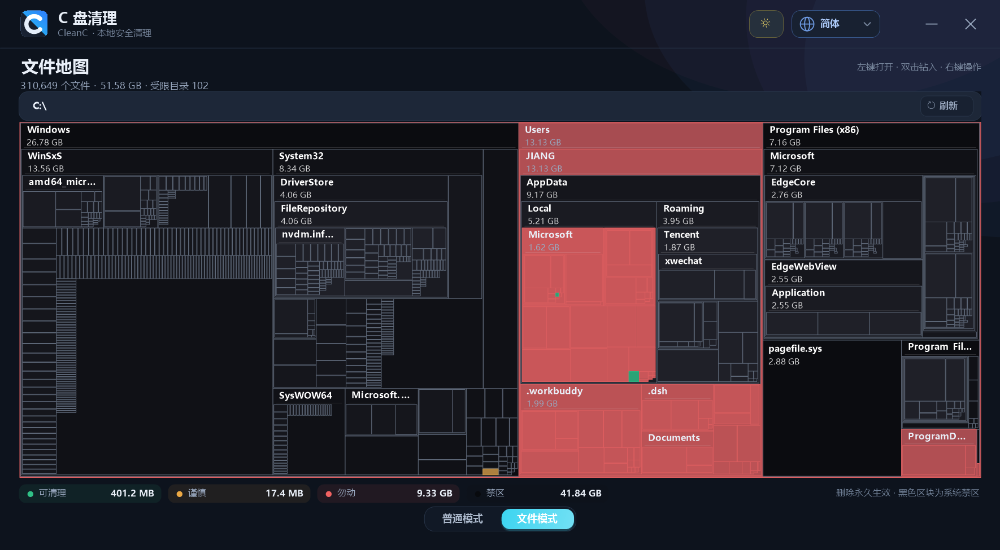 |

## 四档清理的差别在哪

- **看多少**：低 / 中只看白名单里的关键目录；高 / 极限遍历整个 C 盘（跳过重解析点，避免软链接环）。
- **要不要管理员**：低档完全在用户权限内；中档部分系统目录需要；高档受限目录会被计入「受限目录数」；极限档要求管理员，否则直接引导提权。
- **要不要碰注册表**：只有极限档会扫描注册表垃圾，并且删除是**另一道独立确认**。
- **有没有顺序**：只有极限档按 ①→⑥ 的顺序推进（见上），其余档位按风险与体积排序。

## 安全与授权

**AppData 红线**（用户指定的清理原则，已写进代码而不是写在文档里）：

- 永不删除 `AppData\Roaming`、`AppData\LocalLow` 下的任何文件；`IsForbidden()` 用前缀黑名单直接拒绝。
- 永不删除 `AppData`、`AppData\Local` 根目录；用精确匹配黑名单拒绝。
- 只清理 `Local` 下明确命名为缓存的子目录，不碰 `Data / Profile / Settings / Session / Login`。
- 程序正在运行时，它的缓存整块跳过，并在列表里说明跳过了几个。

所有涉及注册表与系统命令的操作，都经过四道闸门：

1. **免责声明弹窗**：逐条列出「将执行什么、作用在哪个目标、会不会备份」，必须勾选「我已阅读并了解上述风险」才能点确认按钮。
2. **管理员授权**：需要时以 `runas` 重新启动自身，并带上 `--tab` / `--level` / `--autoscan` 参数回到原页面。用户取消提权则什么都不执行。
3. **注册表白名单**（`RegGuard`）：
   - 允许：16 步流程里可验证的残留位置 —— `Uninstall`、`App Paths`、`Run / RunOnce` 的值、`StartupApproved` 的值、`SOFTWARE` 深层失效路径值、`Classes` 中可验证的 CLSID / 右键菜单 / shell 动词 / Applications / OpenWith、`Installer\UserData\...\InstallProperties`、`Services`、`EventLog`、`Class\{GUID}` 过滤值、`Enum` 设备实例
   - 拒绝：`SOFTWARE\Microsoft`、`Windows`、`Policies`、`Clients`、`RegisteredApplications` 等系统键；`Security` 事件日志；`ROOT` / `HTREE` 设备；`Program Files\Common Files`、`Microsoft` 等厂商共享目录里的 COM / 关联目标；`Run` 键只允许删值、不允许删键；`Tcpip`、`Disk`、`Ntfs`、`Win*`、`Ms*` 等关键服务
   - 强制卸载只允许删除「该软件自身」的键：`SOFTWARE\{产品}` 或 `SOFTWARE\{厂商}\{产品}`，且键名必须命中产品词（会跳过与发行商同名的词，避免误删厂商公共键，例如删 Chrome 时不会删掉整个 `Software\Google`）
4. **先备份再删**：每个注册表键删除前执行 `reg export` 到 `%LOCALAPPDATA%\CleanC\regbackup\<时间戳>\*.reg`，结果弹窗会显示备份路径，可双击还原。

命令只使用系统自带的固定模板，参数由程序按严格规则拼装，不接受任意输入：

```
taskkill /F /PID <pid>
takeown  /F "<安装目录>" /R /D Y
icacls   "<安装目录>" /grant *S-1-5-32-544:F /T /C /Q
reg export "<键>" "<备份.reg>" /Y     reg delete "<键>" /F
sc stop "<服务>"                      sc delete "<服务>"
schtasks /Delete /TN "<任务>" /F
pnputil /delete-driver <oem*.inf> /uninstall /force
takeown /f "<INF>" /a                 icacls "<INF>" /grant *S-1-5-32-544:F
del /f /q "<INF>"                    rd /s /q "<DriverStore 包目录>"
```

「C 盘清理」页签只做文件删除与回收站操作；`sc` / `schtasks` / `pnputil` / 注册表删除只出现在「残留清理」页签，并且必须逐项勾选、通过免责声明与管理员授权。驱动包删除会**单独打开一个管理员模式的 cmd 窗口**（程序已是管理员则直接继承权限，否则通过 UAC `runas` 提权）：先 `pnputil /delete-driver ... /uninstall /force`；若发布 INF 仍在，则回退 `takeown` + `icacls` + `del` 删除 INF，并按 `DriverDatabase` 映射删除 `DriverStore\FileRepository` 包目录。普通文件清理不会执行 `del` / `rmdir` / `format` / `diskpart` / `bcdedit` / `reg add`，也不会修改分区与启动配置。所有命令、退出码与逐文件结果都写入 `%LOCALAPPDATA%\CleanC\logs\`。

## 清理规则（节选）

| 类别 | 路径示例 | 风险 | 默认 |
|---|---|---|---|
| 用户临时文件 | `%LOCALAPPDATA%\Temp` | 安全可清理（永久删除） | 勾选 |
| 系统临时文件 | `C:\Windows\Temp`、`C:\Windows\SystemTemp` | 安全可清理（需管理员） | 勾选 |
| Windows 更新缓存 | `C:\Windows\SoftwareDistribution\Download` | 安全可清理（需管理员） | 勾选 |
| 浏览器缓存 | Edge / Chrome 的 `Cache`、`Code Cache` 等 | 安全可清理 | 勾选 |
| 应用缓存（Local） | `AppData\Local\*\Cache`、`Code Cache`、`GPUCache`、`ShaderCache` | 安全可清理（跳过运行中的程序） | 勾选 |
| 缩略图缓存 | `thumbcache_*.db`、`iconcache_*.db` | 安全可清理（自动重建） | 勾选 |
| 崩溃转储 | Minidump、MEMORY.DMP、WER | 安全可清理 | 勾选 |
| 回收站 | `C:\$Recycle.Bin` | 清空回收站（不可恢复） | 不勾选 |
| 旧系统备份 | `C:\Windows.old` | 建议确认（永久删除） | 不勾选 |
| 注册表垃圾 | 孤立 Uninstall 项、失效 App Paths、失效 Run 项 | 建议确认（先备份） | 仅极限档出现 |
| 系统核心 | `C:\Windows\System32`、`WinSxS`、`Boot` | **系统保护，禁止删除** | — |
| 程序文件 | `C:\Program Files`、`Program Files (x86)` | **系统保护，禁止删除** | — |
| 用户资料 | 文档、桌面、图片、下载等 | **永不删除** | — |
| 虚拟内存 | `pagefile.sys`、`hiberfil.sys`、`swapfile.sys` | **系统保护，禁止删除** | — |

规则采用最长路径前缀匹配：`C:\Windows` 整体为系统保护，但更深层的 `C:\Windows\Temp` 被明确覆盖为可清理。删除前还会执行硬拦截校验，确保任何受保护路径都不会被清理流程触碰。

### 逐文件判定与风险值（v2.4）

清理不再只统计目录体积。每个可清理类别里的文件都会逐个判定：

| 判定结果 | 例子 | 风险值 |
|---|---|---|
| 缓存数据 | 浏览器 `Cache_Data`、`f_000001`、`GPUCache` | 安全可清理 |
| 临时文件 | `.tmp`、`.temp`、`~$*`、Temp 目录下的无扩展名文件 | 安全可清理 |
| 日志 / 诊断 | `.log`、`.etl`、`.evtx`、`.wer` | 安全（在日志类别为建议确认） |
| 崩溃转储 | `.dmp`、`MEMORY.DMP`、Minidump | 安全可清理 |
| 缩略图 / 图标库 | `thumbcache_*.db`、`iconcache_*.db` | 安全可清理 |
| 字体缓存 / 预读取 | `FontCache*.dat`、`.pf` | 安全（预读取为建议确认） |
| 更新包 / 安装包缓存 | `.cab`、`.msu`、`.wim`、`.msi`、`.msp` | 安全或建议确认 |
| 回收站 / 备份 | `$R*`、`Windows.old`、`.bak` | 建议确认 |
| 可执行文件 | `.exe`、`.dll`、`.sys`、`.bat`、`.ps1` | 建议确认 |
| 配置 / 数据库 | `.json`、`.xml`、`.ini`、`.db`、`.dat` | 建议确认 |
| **个人文档 / 媒体** | `.docx`、`.xlsx`、`.pdf`、`.jpg`、`.mp4`、`.zip` | **个人文件（受保护，永不删除）** |
| 其他 | 无法识别的扩展名 | 建议确认 |

双击任一类目打开「清理详情」即可看到逐文件明细：**类型 chip + 风险 chip + 大小 + 所在目录**，按体积排序最多展示 800 项；头部同时汇总「安全 / 需确认 / 个人文件」的数量。个人文档与媒体即使出现在 Temp 或缓存目录里，也会被标记为受保护并在清理时跳过（日志写入 `SKIP [personal]`），不会被“清理缓存”顺手删掉。

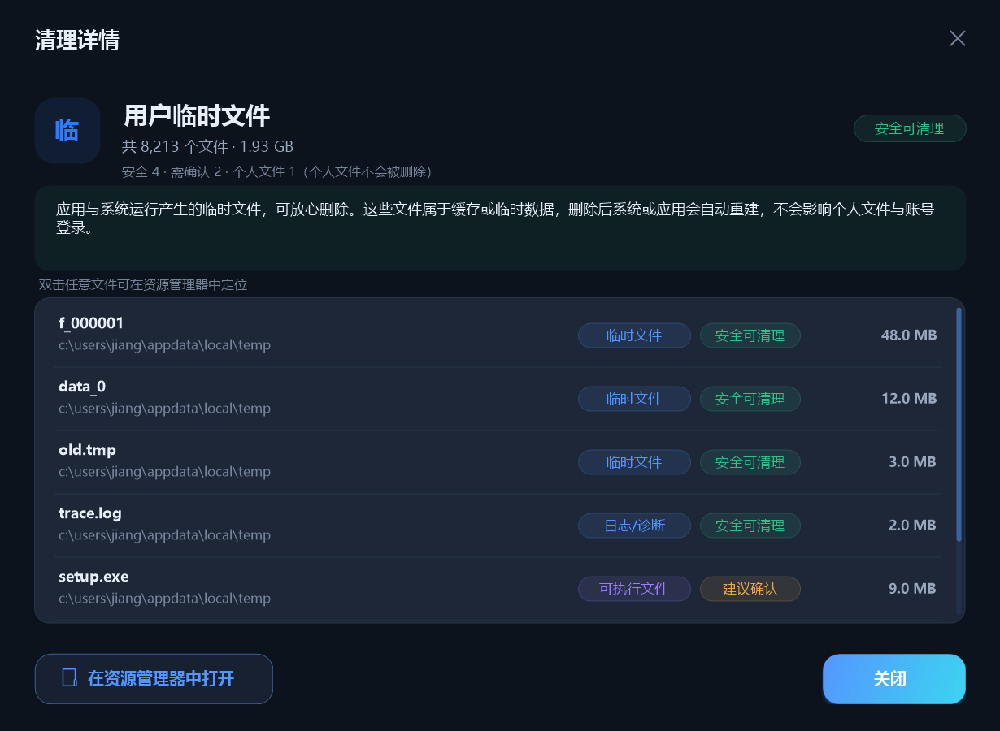

单个类别的文件明细上限提升到 12,000 项，详情列表展示上限 800 项；扫描仍按体积排序，避免大目录把界面拖慢。

## 运行

```
dist\C盘清理.exe
```

命令行参数（可组合）：

```
--tab 1                 启动后停在「卸载软件」页
--tab 2                 启动后停在「残留清理」页
--tab 3                 启动后停在「防护设置」页
--defensenable          启动后直接开启主动防御（写入设置，可配合 --tab 3）
--defenselevel 0|1      指定防御档位：低 / 高（配合 --defensenable）
--mode normal|file      启动后直接进入普通模式 / 文件模式（文件模式会立即扫描）
--level 0|1|2|3         指定清理范围：低 / 中 / 高 / 极限
--autoscan              启动后自动开始扫描（配合 --level）
--theme light|dark      强制指定主题（不写入设置，截图/调试用）
--autotheme 1200        启动 1200 ms 后自动切换一次主题（验证换肤链路）
--uidemo                演示数据（截图用）
--uidialog confirm      直接弹出指定弹窗（截图/调试用：confirm / result / consent / uninstall / force / verify）
--mapdialog hover|menu|junk|delete  文件地图建好后自动演示交互状态（截图/调试用）
--fpsprobe              启动动画结束后持续重绘 4 秒，输出真实帧率 JSON（配合 --out）
--slowsplash            启动动画放慢，便于截图
--scrolldemo            清理列表自动滚到底部（截图用）
```

系统要求：Windows 10 / 11（x64），.NET Framework 4.8（系统自带）。

### 从源码构建

```
powershell -NoProfile -ExecutionPolicy Bypass -File build.ps1
```

- 使用系统自带的 `C:\Windows\Microsoft.NET\Framework64\v4.0.30319\csc.exe` 编译，零第三方依赖。
- 图标由 `tools/make-icon.py` 生成（对角双色 Logo，16–256px 多尺寸 ICO；纯标准库，无需 Pillow），`make-icon.ps1` 只是它的调用包装。
- 构建产物：`dist\CleanC.exe` 与中文名副本 `dist\C盘清理.exe`。

## 界面

| 启动动画 | 卸载软件 |
|---|---|
| 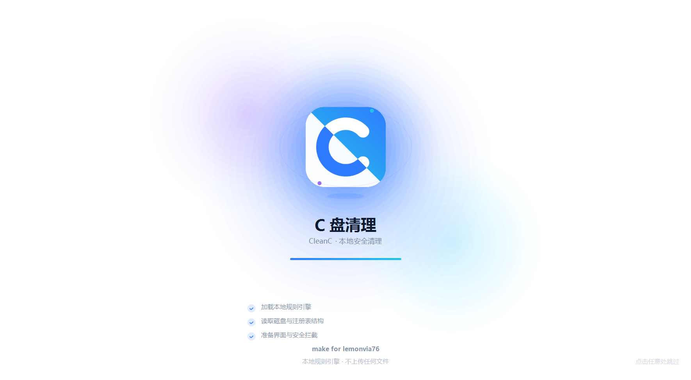 | 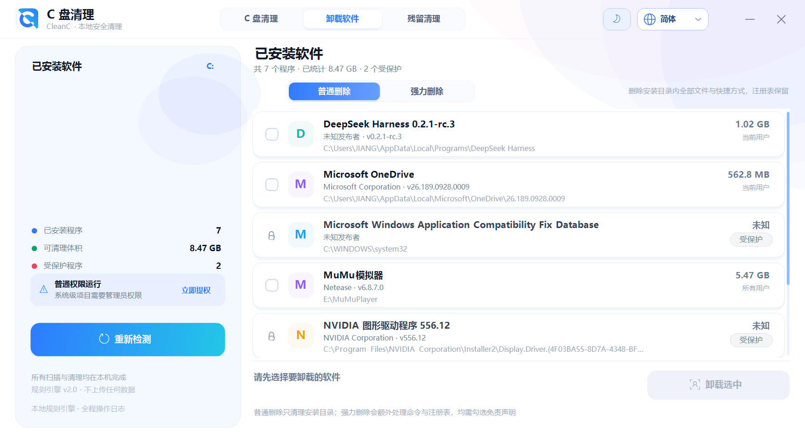 |

| 极限档：按序清理（①②…） | 残留清理（16 步全量扫描） |
|---|---|
|  | 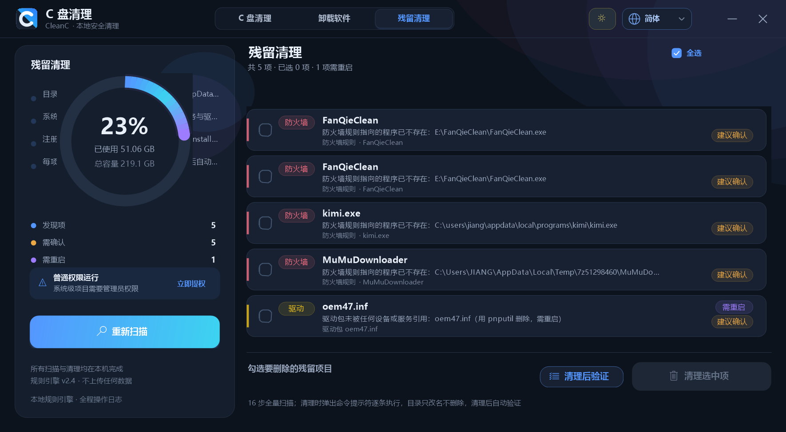 |

| 清理后验证（第 16 步） | 权限与风险确认 |
|---|---|
| 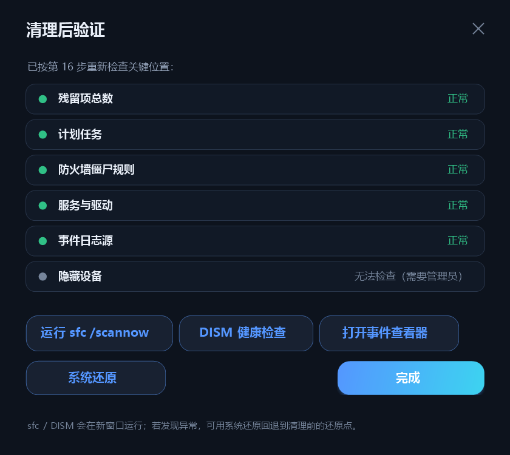 | 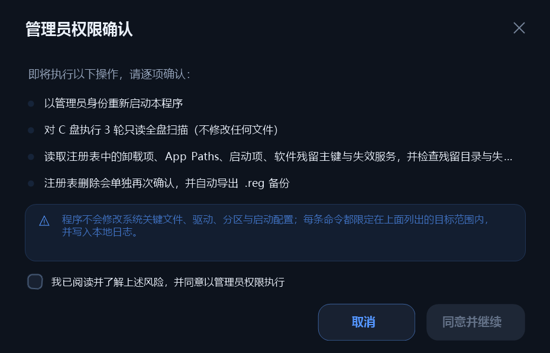 |

| 强力删除确认 | 防护设置 |
|---|---|
| 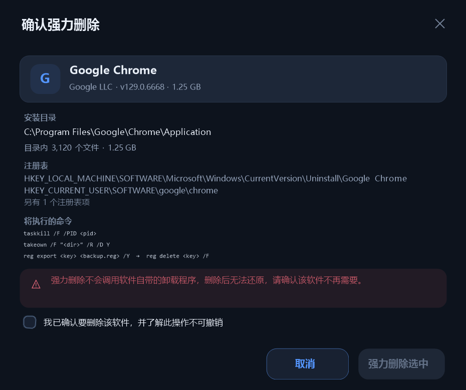 |  |

| 深色主界面 | 深色卸载页 |
|---|---|
|  | 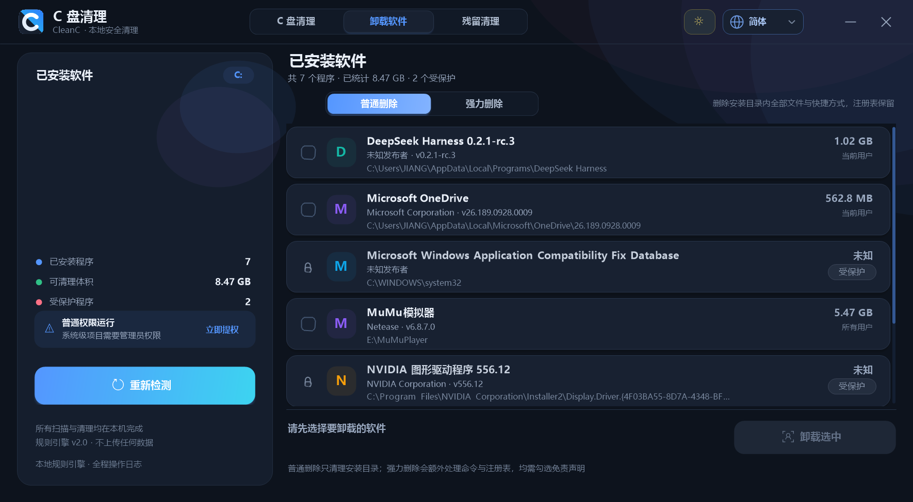 |

## 目录结构

```
app.manifest            清单（asInvoker、DPI、长路径、Common Controls）
build.ps1               构建脚本（图标 + csc + 中文名副本）
src/Program.cs          入口、DPI 缩放、崩溃日志、自检命令
src/Loc.cs              简体中文 / 繁體中文 / English 文案与语言设置
src/Theme.cs            明暗两套调色板、圆角/阴影/文字工具、C Logo、动画引擎
src/Settings.cs         settings.ini 读写（lang / theme），改一个键不覆盖其他键
src/Models.cs           风险级别、扫描档位、分类、程序条目、注册表项模型
src/RuleEngine.cs       规则构建、最长前缀匹配、删除硬拦截、注册表垃圾类别
src/Scanner.cs          四档扫描：定向测量 / 全盘 / 三轮全盘，并按体积收集逐文件明细
src/FileJudge.cs        逐文件判定：类型（缓存/临时/日志/转储/文档/可执行/配置…）与独立风险值
src/Cleaner.cs          二次校验删除、回收站、注册表垃圾清理、日志
src/Guard.cs            正在运行的应用检测（缓存清理前的前置判断）
src/Safety.cs           保护路径判定（被系统保护的目录名单）
src/Uninstaller.cs      程序枚举、普通删除、强力删除、命令封装、注册表守卫
src/RegistryJunk.cs     残留扫描编排：16 步流程、Uninstall / 启动项 / 服务 / 快捷方式
src/ResidualScan.cs     16 步扫描的具体实现：目录 / 任务 / 防火墙 / SOFTWARE 全量 / Classes / Installer / 驱动 / 浏览器 / 事件日志 / 临时缓存 / 验证
src/RegRunner.cs        把 reg export / reg delete、sc、schtasks、pnputil 写成 .bat，并对每个项回查真实状态
src/FileMap.cs          文件地图数据层：目录树扫描、四级风险映射、Squarified treemap 布局、体积回退
src/FileMapView.cs      文件地图画布：区块绘制、面包屑、悬停评价卡、左键/双击/右键、入场动画
src/FileOps.cs          文件操作：剪贴板复制/剪切/粘贴、永久删除、系统属性框、垃圾排查与批量清理
src/FileDialogs.cs      右键盘点、通用确认/消息弹窗、垃圾清理排查报告
src/Defense.cs          主动防御引擎：完整性基线与 SHA-256、关键注册表 / IFEO 校验、启动项与危害文件扫描、可疑进程终止、后台监控与日志
src/DefenseUI.cs        防护页：开关 / 档位 / 统计、风险列表、风险详情与处置弹窗、右下角拦截提示
src/MainForm.cs         无边框主窗体、普通/文件模式切换、四页签、四档选择、扫描/清理/卸载/残留/防护/验证流程
src/Controls.cs         分段控件、按钮、环形图、分类列表、程序列表、注册表列表、启动动画
src/Dialogs.cs          确认/详情/结果/免责声明/卸载确认/程序信息/清理后验证弹窗
tools/make-icon.py     对角双色 Logo 图标生成（纯标准库）
tools/make-icon.ps1    make-icon.py 的 PowerShell 包装
tools/shot.ps1          开发用窗口截图脚本（PrintWindow）
```

## 自检命令（开发用）

```
dist\C盘清理.exe --selftest --out selftest.json         # 全盘扫描 + 分类断言
dist\C盘清理.exe --safetytest --out safetytest.json     # 保护路径拦截 + Temp 探针删除
dist\C盘清理.exe --cleantest --out cleantest.json       # 临时目录探针清理
dist\C盘清理.exe --uninstalltest --out uninstall.json   # 卸载枚举 + 注册表守卫断言
dist\C盘清理.exe --removetest --out removetest.json     # 普通/强力删除探针（真实删临时目录）
dist\C盘清理.exe --regcleantest --out regclean.json     # 注册表/目录残留清理探针 + 逐项回查
dist\C盘清理.exe --regscan --out regscan.json           # 导出全部残留扫描结果（含步骤号 / 类型 / 路径）
dist\C盘清理.exe --verifytest --out verify.json         # 第 16 步验证的六项检查结果
dist\C盘清理.exe --tasktest --out tasktest.json         # 造计划任务 → 扫描 → 删除 → 回查（非管理员可跑）
dist\C盘清理.exe --filetest --out filetest.json         # 文件地图：目录树体积、四级风险映射、Squarified 布局、垃圾排查与清理
dist\C盘清理.exe --defensetest --out defensetest.json   # 防御引擎：SHA-256 变化、双扩展名 / 可疑路径 / 伪装系统名判定、启动项扫描、隔离链路
dist\C盘清理.exe --fpsprobe --out fps.json              # 实测主界面 / 启动动画帧率（帧数、绘制耗时）
```

本机实测（非管理员）：

| 自检 | 结果 |
|---|---|
| `--selftest` | 扫描 305,821 个文件 / 约 51.8 GB，用时 13.6 s；**16 项分类断言 + 9 项逐文件类型 / 风险断言全部通过** |
| `--safetytest` | System32 / 文档 / pagefile 全拦截；**Roaming、LocalLow、Local 根目录全部禁止**；`Local\Temp` 仍允许；9 个应用缓存根目录被发现并归类为 `app_cache` |
| `--cleantest` | 3 个 `.tmp` + `setup.exe` 全部清理，`report.pdf` 被判定为个人文件并保留（`pdfKept: true`、`skipped: 1`），空子目录回收，日志写入 |
| `--uninstalltest` | 7 个程序 / 2 个受保护（Windows 兼容性数据库、NVIDIA 驱动）；23 项守卫断言全部通过（含 Classes / Installer / EventLog / Enum / 深层路径值 / 驱动强制删除脚本与 DriverStore 映射） |
| `--removetest` | 普通删除与强力删除各清空 20,480 B 探针、0 失败、0 个注册表键被误删；受保护条目被正确拒绝 |
| `--regcleantest` | 造出假卸载项 + 残留目录 + 10 MB 临时文件 → 3 个探针全部被 16 步扫描命中 → 删除后**回查确认键已消失**（`keyGone: true`）、目录被改名（`folderRenamed: true`）、临时文件被删除（`tempFileDeleted: true`）；0 失败 |
| `--regscan` | 本机当前扫描 6 项：防火墙僵尸规则 4、驱动包 1、更新缓存 1；扫描约 11 s（驱动包数量会随系统已安装/已删除的驱动变化） |
| `--verifytest` | 六项验证全部可执行：计划任务 / 事件日志 / 隐藏设备正常；防火墙 4 项与 1 个失效服务仍列为残留（清理前快照） |
| `--tasktest` | 建一个指向不存在 exe 的计划任务 → COM 扫描命中 → `schtasks /delete` 删除 → 回查任务已消失（`ok: true`） |
| `--filetest` | 临时目录造树：体积 / 文件数正确；六级风险映射全部命中；Squarified 布局无重叠且覆盖容器；垃圾排查 4 项可清理，清理时个人文档被跳过（`deleted: 3`、`skipped: 1`） |
| `--defensetest` | SHA-256 前后变化、双扩展名 / 可疑路径 / 伪装系统名判定、启动项扫描、隔离链路全部通过（`ok: true`、`quarantineOk: true`） |

## 已知限制

- **Smart App Control / WDAC**：本机启用了要求「企业签名级别」的 Code Integrity 策略，未签名的新 exe 会被系统拦截（事件 ID 3077/3033）。程序本身没有、也不会修改任何系统安全策略；在常见的、未启用该策略的 Windows 10/11 上可直接运行。
- 非管理员无法读取/清理部分系统级目录（如 `C:\Windows\Temp`、`C:\Windows\SystemTemp`），界面会展示受限目录数量并提供提权按钮。
- 正在被浏览器或系统服务占用的缓存文件可能删除失败，结果弹窗会列出跳过数量。
- 清理 Windows 更新缓存时不会停止 Windows Update 服务；被占用文件会跳过。
- 强力删除不是「官方卸载程序」：MSI 安装的软件不会走 `msiexec /x`，卸载后可再用「残留清理」的 16 步扫描补齐沟壑。
- 16 步扫描只认可验证证据（目标文件 / 键确实不存在才判定），不做猜测式清理；为避免首次打开卡住，`SOFTWARE` 与 `Classes` 全量递归分别设有 12 s / 16 s 时间预算与 140k / 200k 键上限，超大注册表可能截断（结果有上限，不会误删）。
- 文件地图首次建立需要遍历全盘（本机 31 万文件约 30–40 s），期间可取消；节点上限 400,000，超出后部分目录不再下钻。刷新会重新统计，不做文件系统实时监视。
- 文件地图里的「删除」是永久删除（不进回收站），黑色禁区与 `C:\` 顶层目录被禁止；需要可恢复删除时请用普通模式的清理流程。
- 驱动包「未被引用」的判定基于注册表 `InfPath` 交叉引用；删除驱动包默认不勾选，执行时会单独打开管理员 cmd。`pnputil` 失败后会回退删除发布 INF 与 `DriverStore\FileRepository` 包目录，这是破坏性兜底，执行后建议重启并在设备管理器确认。
- 浏览器扩展数据默认不勾选，执行前应先完全退出浏览器，否则改名会失败。
- 残留目录默认**只改名不删除**（`xxx.CleanC_bak`），需要你确认后手动清理；程序不会替你删掉一个可能还存着配置或存档的目录。
- 第 16 步的 `sfc /scannow`、`DISM /CheckHealth` 需要管理员权限，会以新窗口运行，程序只提供入口，不在后台静默执行。
- 主动防御只在 CleanC 运行期间生效，不做常驻服务 / 驱动；关闭主程序后监控即停止。
- 系统文件完整性以「SHA-256 + 版本信息」判定：微软签发的系统更新会静默刷新基线，因此只报告非微软更新造成的改动；被完整保留版本信息的篡改可能漏报。
- 终止进程受权限限制：普通权限只能终止当前用户的可疑进程；恢复 `HKLM` 注册表值、删除系统级启动项需要管理员（界面会提示改用左下角「立即提权」）。
- 启动项与危害文件识别是启发式规则，自定义脚本可能被误报；默认只隔离、不直接删除，且隔离文件后不会自动清理对应启动项（需再点「禁用启动项」）。

## English

CleanC is a local-only Windows 10/11 cleanup utility for the `C:` drive.

- **Single-file exe, no installer** — run `dist/CleanC.exe` (or `dist/C盘清理.exe`) directly. Requires .NET Framework 4.8, which ships with Windows 10/11.
- **Normal mode** — four scan scopes, per-file risk verdicts, category lists, safe cleanup, app uninstaller, 16-step residual sweep and post-clean verification.
- **Active defense** — optional low/high-frequency monitoring of 12 System32 binaries, critical registry values and IFEO hijacks; signed Microsoft updates refresh the baseline automatically. Tampering raises a bottom-right toast, terminates processes started from suspicious folders, and lists risky startup items / hidden executables with one-click quarantine or disable actions. Files can be quarantined; nothing is deleted outright.
- **File map mode** — SpaceSniffer-style treemap sized by volume, four risk colors (green / yellow / red / black), hover summary, click to open, double-click to zoom, right-click delete / cut / paste / copy / properties / junk scan. Black zones (System32, WinSxS, Program Files, AppData red lines) can never be deleted or cut.
- **Safety** — every destructive action is re-validated against the rule engine; registry changes are exported before deletion; nothing is uploaded.
- UI languages: Simplified Chinese, Traditional Chinese and English (first run follows the system language).
- Build from source on Windows: `powershell -NoProfile -ExecutionPolicy Bypass -File build.ps1`.

## License

[MIT](LICENSE)

